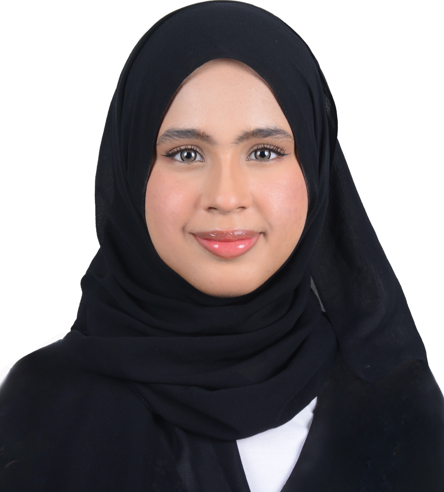

  
  <h1>Hi there, I'm Qistina Balqis! 👋</h1>

  
  
  

An aspiring **Data Engineer** currently pursuing a Bachelor of Computing (Data Engineering) at Universiti Teknologi Malaysia (UTM). With a strong foundation in STEM and engineering, I am passionate about leveraging technology, logic, and data analytics to build impactful solutions. Beyond academics, I am an active student leader, youth ambassador, and advocate for community and environmental initiatives.

---

## 🚀 Quick Snapshot

* **🎓 Education:** B.Sc. Computing (Data Engineering) @ UTM (2026–Present)
* **💡 Background:** 4.00 CGPA Foundation in Engineering graduate (UiTM Dengkil)
* **🌱 Currently Learning:** Fundamental programming concepts, data structures, and expanding my core technical stack.
* **🎯 Interests:** Data pipelines, analytical problem solving, and tech for social good.

---

## 🛠️ Skills & Competencies

* **Core & Technical Concepts:** Data Engineering Fundamentals, STEM & Engineering Logic
* **Languages & Communication:** English (CEFR C1 / MUET Band 4.5), Malay (Fluent)
* **Leadership & Management:** Event Coordination, Logistics, Project Management
* **Soft Skills:** Cross-Cultural Communication, Community Advocacy, Team Collaboration

---

## 🏆 Leadership & Community Involvement

* **Event Coordinator** | Indonesian Youth Exchange.
* **Activity Director** | Extreme Club, UiTM Dengkil.
* **Vice President & Secretary** | Travel Club & Pandu Puteri Malaysia.
* **Volunteer & Advocate** | Participated in the *Stand Together for Peace* campaign (World Thinking Day) and led local efforts in the *National Plastic Buster Beach-River-Park* clean-up.

---

## 📫 Let's Connect

* **Email:** [qiseono@gmail.com](mailto:qiseono@gmail.com)
* **GitHub:** [your-github-username](https://github.com/qiseono)

<!--
**qiseono/qiseono** is a ✨ _special_ ✨ repository because its `README.md` (this file) appears on your GitHub profile.

Here are some ideas to get you started:

- 🔭 I’m currently working on ...
- 🌱 I’m currently learning ...
- 👯 I’m looking to collaborate on ...
- 🤔 I’m looking for help with ...
- 💬 Ask me about ...
- 📫 How to reach me: ...
- 😄 Pronouns: ...
- ⚡ Fun fact: ...
-->
